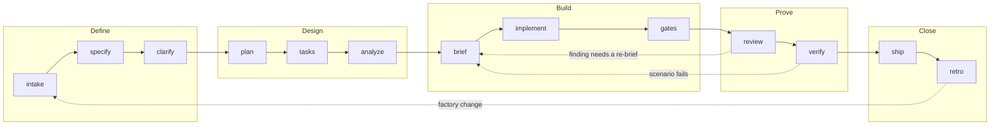

# 2. The pipeline

Thirteen stages. Each has an owner, inputs, outputs and an exit criterion that `factory advance`
checks. State is stored in `specs/<NNN-feature>/state.json`, so any session (or any person) can
pick up where the last one stopped.



## Stage reference

### 1. intake
- **Owner**: orchestrator with the requester.
- **Output**: `intake.md` (scaffolded by `factory feature new`): the request in the requester's words, who it is for, constraints, non-goals, open questions.
- **Exit**: `intake.md` is non-empty.
- **Why it exists**: the cheapest moment to discover that the request is not what it seemed. Non-goals written now prevent scope creep later.

### 2. specify
- **Owner**: orchestrator via `/speckit-specify`.
- **Output**: `spec.md`: user stories, acceptance scenarios (given/when/then), functional requirements, success criteria. No technology choices.
- **Exit**: `spec.md` is non-empty.

### 3. clarify
- **Owner**: orchestrator via `/speckit-clarify`, with the human answering.
- **Output**: `spec.md` with every `[NEEDS CLARIFICATION: ...]` marker resolved.
- **Exit**: no markers remain.
- **Rule**: the orchestrator asks; it never chooses silently. A guessed requirement is the most expensive kind of bug because every later stage builds on it correctly.

### 4. plan
- **Owner**: the `architect` subagent or `/speckit-plan`.
- **Output**: `plan.md`: approach, contracts (data shapes, signatures, schema changes), slices with file lists and dependencies, risk register, rejected alternatives. Long-lived decisions become ADRs.
- **Exit**: `plan.md` is non-empty.

### 5. tasks
- **Owner**: `/speckit-tasks`.
- **Output**: `tasks.md`: dependency-ordered checklist (`- [ ] T001 ...`), parallel tasks marked.
- **Exit**: at least one checklist item.

### 6. analyze
- **Owner**: `/speckit-analyze`.
- **Output**: `analysis.md`: cross-checks spec, plan and tasks for gaps, contradictions and requirements without tasks.
- **Exit**: no unresolved CRITICAL issues (`CRITICAL: 0`).
- **Why it exists**: it is ten times cheaper to find that a requirement has no task here than in review.

### 7. brief
- **Owner**: the `brief-writer` subagent, reviewed by the orchestrator.
- **Output**: one `briefs/<id>.md` per slice. See [04-delegation.md](04-delegation.md).
- **Exit**: every brief passes `factory brief check`.

### 8. implement
- **Owner**: implementers, via `factory delegate`. The orchestrator reviews each diff.
- **Output**: code changes; one `accepted` ledger row per brief.
- **Exit**: every brief id has an accepted row.

### 9. gates
- **Owner**: orchestrator, `factory gates`.
- **Output**: `.factory/gates.stamp.json` tied to a fingerprint of the tree.
- **Exit**: the stamp is green and matches the current tree. Any later edit invalidates it.

### 10. review
- **Owner**: layered. Free first pass (`scripts/factory/review.sh`), the `reviewer` subagent, and the `security-auditor` when risky. See [06-review.md](06-review.md).
- **Output**: `review.md` as a checklist of findings, each closed as fixed or rejected with a reason.
- **Exit**: no unchecked `- [ ]` lines.

### 11. verify
- **Owner**: the `verifier` subagent or the orchestrator in a browser.
- **Output**: `verify.md`, one block per acceptance scenario, each with an `Evidence:` line.
- **Exit**: at least one `Evidence:` line, and in practice one per scenario.

### 12. ship
- **Owner**: orchestrator.
- **Output**: commits on the feature branch (one per slice), push, pull request.
- **Exit**: clean working tree.

### 13. retro
- **Owner**: orchestrator and the human.
- **Output**: `retro.md`: numbers from `factory report`, what broke and where it should have been caught, concrete factory changes.
- **Exit**: `retro.md` is non-empty. The feature becomes `done`.

## The quick lane

Small, low-risk changes (a bug fix, a copy change, a dependency bump) do not need a spec, a plan
or Spec Kit. Start them in the quick lane:

```bash
factory feature new fix-date-format --lane quick
```

The quick lane runs six stages: `intake → brief → implement → gates → review → ship`. The
exit criteria are the same as in the full lane, so the controls that prove the work stay on:
validated briefs with `allowed_files`, an accepted run in the ledger, a green gate stamp on the
current tree, and a review with no open findings.

What it drops is the design work: `specify`, `clarify`, `plan`, `tasks`, `analyze`, `verify`
and `retro`. To keep that safe, the `brief` stage refuses any brief whose `allowed_files` match
`riskyPaths` (auth, payments, billing, migrations by default). Work that touches those paths
belongs in the full lane. An override is possible but, like every override, it is recorded.

The lane is stored in `state.json` and shown by `factory status` (`3/6 quick`). Use it when the
intake fits in a paragraph; if you find yourself writing a spec in the brief, start over in the
full lane.

## Overrides

```bash
factory advance 004-refunds --override "one-file fix; spec and plan are the bug report"
```

The override is written to `state.json` with the blockers it skipped. Reviewing overrides in
the retro is how a team notices that a stage is either too heavy (overridden every time) or
being skipped when it should not be.

## Loops back

The pipeline is linear in state but not in work. A confirmed review finding that needs more
than a small fix goes back to a new brief. A failing verify scenario goes back to a brief. The
stage does not move backwards; you add a brief, implement it, re-run the gates and continue.
