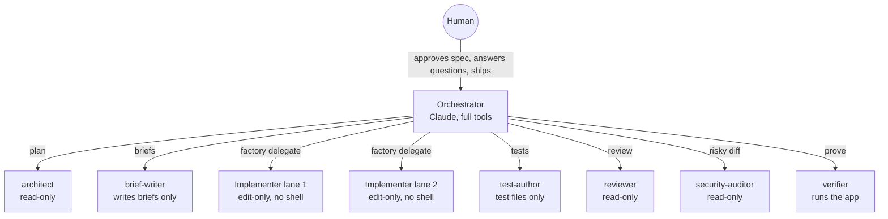

# 3. Roles

The factory has one orchestrator, a pool of implementers, and a set of specialist subagents.
Each role has the minimum tools it needs. Least privilege is not just about safety: an agent that
cannot run the shell cannot "fix" a failing test by deleting it.

## Orchestrator

Claude Code in the main session, on the strongest model you have. It is the only role that:

- talks to the human,
- decides scope and approves the plan,
- runs the shell (installs, gates, git),
- accepts or rejects an implementer's diff,
- commits.

It loads the `software-factory` skill at the start of every feature and follows it.

## Implementers

Any coding agent behind the [adapter contract](04-delegation.md#adapter-contract). The kit
ships two lanes: OpenCode (free models, edit-only permission set) and headless Claude (`claude -p`
on a smaller model, shell and web disallowed). Add more by copying `adapters/_template.sh`.

Implementers:

- see the brief and the repository, nothing else,
- may read, search and edit files,
- may not run commands, reach the network, read `.env`, touch `.git` or commit,
- must end with the report the brief asks for.

## Subagents

Defined in `.claude/agents/*.md`. Each runs in its own context window, so its exploration does
not fill the orchestrator's context, and each declares its own tool list.

| Agent | Stage | Tools | Writes |
|---|---|---|---|
| `architect` | plan | Read, Grep, Glob, Bash (inspection) | `plan.md`, ADR drafts |
| `brief-writer` | brief | Read, Grep, Glob, Write | `briefs/*.md` |
| `test-author` | implement | Read, Grep, Glob, Edit, Write, Bash | test files only |
| `reviewer` | review | Read, Grep, Glob, Bash | `review.md` |
| `security-auditor` | review (risky) | Read, Grep, Glob, Bash | `review.md` `## Security` |
| `verifier` | verify | Read, Grep, Glob, Bash | `verify.md` |

## Model choice

| Role | Model class | Why |
|---|---|---|
| Orchestrator | strongest (Opus) | Every decision downstream inherits its mistakes |
| architect, reviewer, security-auditor | strongest | Judgment, not typing |
| brief-writer, test-author, verifier | mid (Sonnet) | Structured work with clear templates |
| Implementers | cheapest that passes review | Measured by the ledger, not by reputation |

The last row is the point of the ledger. "This model is good at code" is a reputation. "This
model has a 78% accept rate on frontend briefs in this repo at $0.04 per accepted slice" is a
fact you can route on. See [11-metrics.md](11-metrics.md).

## The human

The factory does not remove the human; it moves them to the decisions that need them:

- intake: what and why,
- clarify: answering questions,
- plan: approving the approach for anything non-trivial,
- ship: merging,
- retro: deciding which factory changes are worth making.
