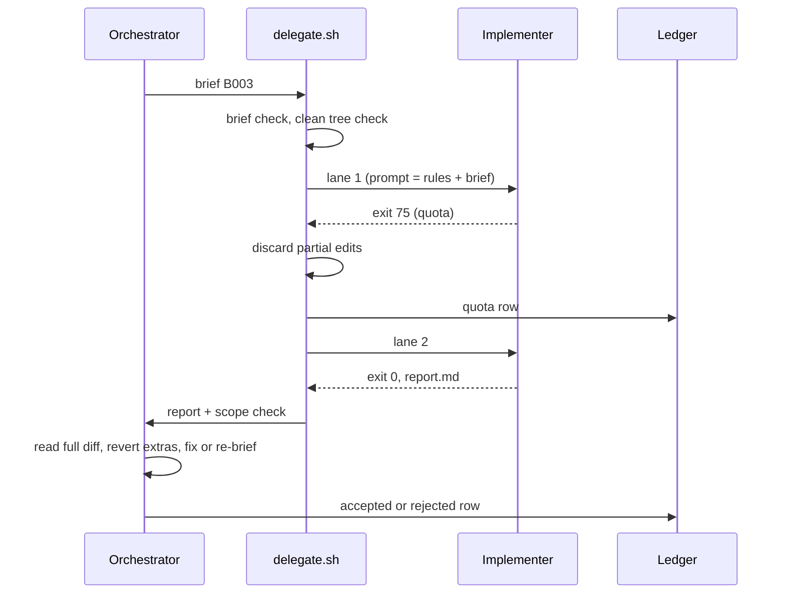

# 4. Delegation

Delegation is where the factory saves money and where it most often goes wrong. The brief is the
contract; the adapter is the plug; the scope check is the enforcement.

## The brief

A brief is a markdown file with validated frontmatter. `factory brief check` rejects a brief that
is missing any field, uses a catch-all glob, or lacks the Context and Report sections.

```markdown
---
id: B003
title: Add refund endpoint to orders API
goal: Let admins refund a captured order in full or in part. Partial refunds are the main ask from support.
risk: high
allowed_files:
  - src/orders/orders.controller.ts
  - src/orders/orders.service.ts
  - src/orders/orders.service.test.ts
  - src/orders/dto/refund.dto.ts
forbidden_files:
  - src/generated/**
forbidden:
  - Do not run shell commands
  - Do not commit
  - Do not touch files outside allowed_files
  - Do not change the Prisma schema; the refunds table already exists
done_when:
  - POST /orders/:id/refunds with amount <= captured creates a refund and returns 201
  - amount > remaining captured returns 422 with code REFUND_EXCEEDS_CAPTURE
  - the route requires the orders.refund permission
  - unit tests cover full, partial, over-refund and unauthorized
gates:
  - lint
  - typecheck
  - test
---

## Context
...real code excerpts with path:line...

## Steps
...

## Pitfalls
...

## Report
...
```

### What makes a brief good

| Property | Bad | Good |
|---|---|---|
| Files | `src/orders/**` | the four files, named |
| Done | "refunds work" | "over-refund returns 422 with code REFUND_EXCEEDS_CAPTURE" |
| Context | "follow existing patterns" | the actual `createOrder` handler pasted with its line number |
| APIs | "use the payment client" | `paymentClient.refund(captureId: string, amount: number): Promise<Refund>` from `src/payments/client.ts:22` |
| Decisions | "handle errors appropriately" | "throw `UnprocessableEntityException` with `{ code }`; see `src/orders/errors.ts:8`" |

The single biggest cause of rejected implementer runs is a missing signature. When a model is not
shown a function it needs, it invents one that looks plausible. Paste the signatures.

### Sizing

One brief is one reviewable diff: under about 400 changed lines, one concern, leaves the tree
green on its own. If a brief needs more than eight files, it is two briefs.

## Adapter contract

Every implementer is a shell script in `scripts/factory/adapters/` with the same contract:

```
args:   --prompt FILE --out DIR [--model MODEL]
cwd:    repository root
writes: DIR/report.md   final message (required; empty means failed)
        DIR/log.txt     stderr and debug output
exit:   0   completed
        75  quota, rate limit or temporarily unavailable -> try the next lane
        *   failed
```

Lanes are listed in order in `factory.config.json`:

```json
"implementers": [
  { "name": "opencode", "adapter": "scripts/factory/adapters/opencode.sh", "model": "opencode/big-pickle" },
  { "name": "claude-headless", "adapter": "scripts/factory/adapters/claude.sh", "model": "claude-sonnet-5-5" }
]
```

`delegate.sh` walks the lanes. On exit 75 it discards the partial edit, records a `quota` row
in the ledger and tries the next lane. This is how the factory keeps working when a free tier
runs out halfway through a feature.

### Sandboxing is the adapter's job

The standing rules at the top of every prompt ("do not run shell commands") are a request. The
adapter must make them true:

- **OpenCode**: a permission set passed through `OPENCODE_CONFIG_CONTENT`, which has the highest
  precedence, so a project `opencode.json` cannot loosen it. Bash, web, sub-agents, external
  directories, `.env` and `.git` are denied.
- **Claude headless**: `--disallowedTools "Bash WebFetch WebSearch Task"`, and the project's
  own hooks still run inside the subprocess.
- **A CLI with no permission system**: run it in a container with only the repo mounted, no
  credentials and no network except the model endpoint.

## The loop



### After a run

1. **Read the whole diff.** The report says what the implementer meant to do.
2. **Scope.** `factory scope <brief>` exits 2 on any file outside `allowed_files`. Revert the extras. Do not keep helpful additions; they were not reviewed against a plan.
3. **Wrong once**: add the specific defect to the brief's Pitfalls, reset, re-dispatch.
4. **Wrong twice**: do it yourself and record `rejected`. Two failures means the brief is too
   ambiguous or the slice too hard for that lane; the ledger will show which.
5. **Right**: install any dependency the brief needed (implementers have no shell), then
   `factory ledger add ... --outcome accepted`.

## Parallel slices

Slices marked parallel in `plan.md` touch disjoint files. Run them in separate git worktrees so
each implementer's diff is reviewable alone:

```bash
git worktree add ../repo-B004 -b feat/refunds-B004
(cd ../repo-B004 && scripts/factory/delegate.sh specs/004-refunds/briefs/B004.md)
```

Merge the worktree branches back one at a time, re-running the gates after each.
