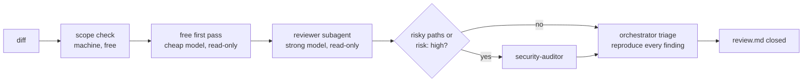

# 6. Review

Review is layered because each layer has a different cost and a different blind spot.



| Layer | Cost | Good at | Blind to |
|---|---|---|---|
| `factory scope` | zero | files outside the brief | everything else |
| `factory review <feature>` | free | obvious bugs, missing tests, a second opinion | project context, subtle logic; produces false positives |
| `reviewer` subagent | moderate | contract vs code, invented APIs, project rules | attack thinking |
| `security-auditor` | moderate | authz, injection, money, migrations | product behaviour |
| `factory risk` | zero | deciding whether the auditor is needed | |

### The free first pass

`factory review <feature> [--base REF]` sends the diff to a cheap model and appends its findings
to `review.md` as unchecked `UNVERIFIED` items, so the review stage cannot be left until each one
is triaged. The reviewer gets the same handbook context an implementer would get for the changed
files. Diffs over `reviewMaxBytes` (default 150000) are cut, and the reviewer is told to open the
rest itself.

The lane is `reviewer` in `factory.config.json`. The default is the OpenCode adapter with its
read-only permission set. `REVIEW_MODEL` overrides the model for one run.

```json
"reviewer": { "adapter": "scripts/factory/adapters/opencode.sh", "model": "opencode/big-pickle" }
```

The reviewer adapter is called with `FACTORY_READONLY=1` (and `OPENCODE_PERMISSIONS=readonly`). An
adapter used as a reviewer must switch to a no-edit permission set when it sees that variable. If
the reviewer is unavailable, the command reports it and exits 0: the `reviewer` subagent is the
real review.

## Every finding is a hypothesis

The rule that makes layered review work: **no finding is acted on until the orchestrator has
reproduced it.** Open the file, read the surrounding code, construct the failing input. Then
close the line in `review.md`:

```markdown
- [x] CONFIRMED high  src/orders/orders.service.ts:88  Partial refund refunds the full capture.  -> fixed in orders.service.ts, test added
- [x] REJECTED  med   src/orders/orders.controller.ts:31  "Missing auth check"  -> guard is applied at controller level, line 12
- [x] UNVERIFIED low  src/orders/dto/refund.dto.ts:4  "amount can be negative"  -> CONFIRMED, z.number().int().positive() added
```

`factory advance` will not leave the review stage while any `- [ ]` line remains. The free first
pass writes its findings as unchecked `UNVERIFIED` lines on purpose: they cannot be ignored,
and they cannot be trusted.

Rejected findings are as valuable as confirmed ones. A pattern of the same false positive is a
signal to add context to the reviewer prompt or to the handbook.

## What the reviewer checks, in order

1. **Scope**: anything outside `allowed_files` stops the review.
2. **Contract**: each `done_when` is traced to code and a test.
3. **Correctness**: states (empty, error, loading, concurrent), boundaries, types.
4. **Invented APIs**: every called symbol exists with that signature. Grep, do not assume.
5. **Project rules**: golden rules and the handbook checklist.
6. **Tests**: new behaviour has a test that fails without the change.
7. **Dead weight**: unused returns, duplicated helpers, speculative abstraction.

## The review checklist grows from real defects

The project handbook keeps a numbered checklist. Every entry comes from a defect that an
implementer actually produced, with the exact shape of the mistake and how to spot it:

```markdown
### 7. No hardcoded localized paths
- Defect: `navigateTo('/admin')` in an i18n app strips the `/en` prefix and drops English users into Arabic.
- Check: grep the diff for `to="/` and `navigateTo('/`; every internal path goes through `localePath()`.
- Enforced by: review only (candidate for a lint rule).
```

The "Enforced by" line is a to-do list. Each "review only" entry is a candidate for a lint rule,
a test or a hook. Over time the checklist shrinks into gates.

## After review

Fixes invalidate the gate stamp. Run `factory gates` again before leaving the stage. If a fix is
more than a few lines, it is a new brief, not a review fix.
