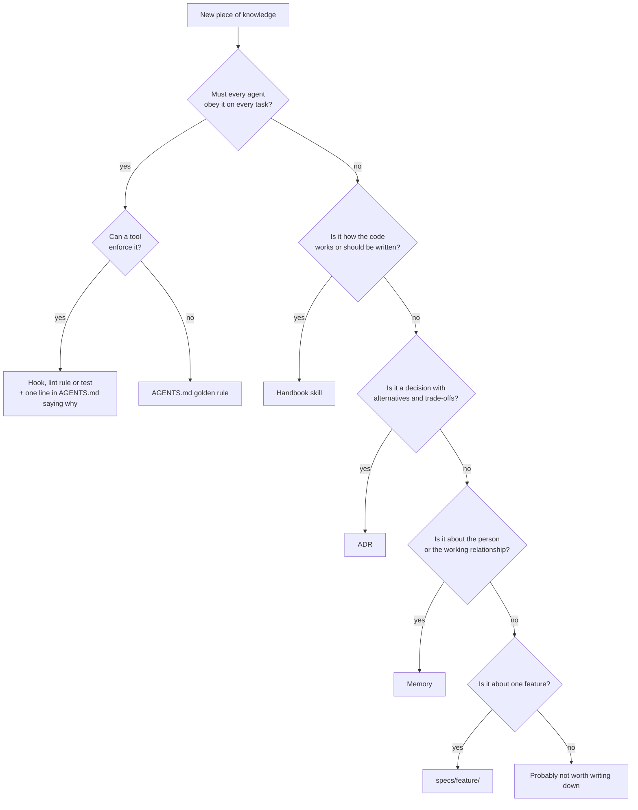

# 8. Knowledge layers

Agents start every session with no memory. What they know comes from files. The factory uses
five layers, and each piece of knowledge belongs in exactly one.

| Layer | File | Loaded | Holds | Changes |
|---|---|---|---|---|
| Rules | `AGENTS.md` (imported by `CLAUDE.md`) | every session, always | golden rules, layout, gates, commit rules | rarely |
| Handbook | `.claude/skills/<project>-engineering/` | on demand, by description | architecture, conventions, review checklist, depth | per feature |
| Procedure | `.claude/skills/software-factory/` | on demand | how to run the pipeline | per retro |
| Decisions | `docs/adr/NNNN-*.md` | when relevant | why the system is the way it is | append only |
| Memory | Claude Code auto-memory | every session, index only | user preferences, standing instructions, project context not in the code | as learned |
| State | `specs/<feature>/` | at session start (hook) | where each feature stands | constantly |

## Where does this go?

## Rules for each layer

### AGENTS.md
- Under 15 rules, each checkable. If you cannot say how a reviewer would detect a violation, it is not a rule.
- Tool-agnostic. Other coding agents read `AGENTS.md` too; keep Claude-specific workflow in `CLAUDE.md`.

### Handbook skill
- The `description` frontmatter decides when it loads. Make it say exactly when: "Load before writing, reviewing or planning any code in this repo."
- `SKILL.md` under 300 lines; depth in `references/`, linked from a table that says when to read each.
- The review checklist lives here and grows only from real defects.

### Memory
- One fact per file, with the reason it matters.
- Never what the code or git history already records. Memory is for what cannot be derived: preferences, standing instructions, context from outside the repo.
- Correct or delete stale memories. A wrong memory is worse than none because it is trusted.

### ADRs
- Written when a decision will outlive the feature and someone will later ask "why did we do it this way".
- Never edited after acceptance; superseded by a new ADR instead.

### State
- `state.json` and the stage artifacts are the source of truth for progress. A new session reads them through the SessionStart hook and resumes, instead of reconstructing from chat history.
